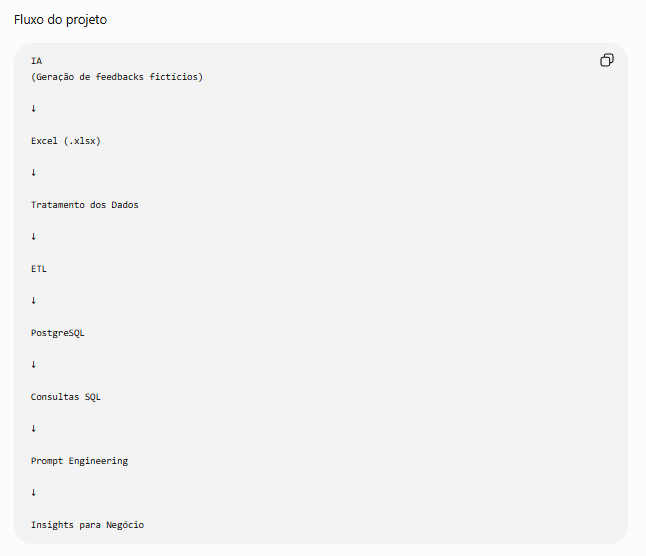
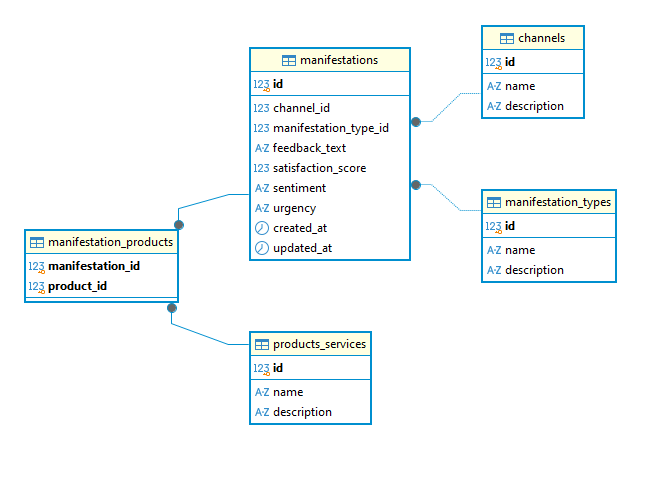
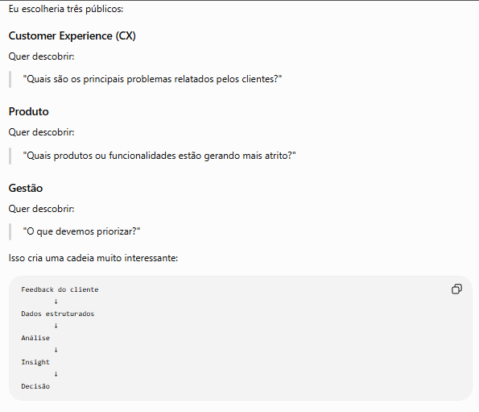
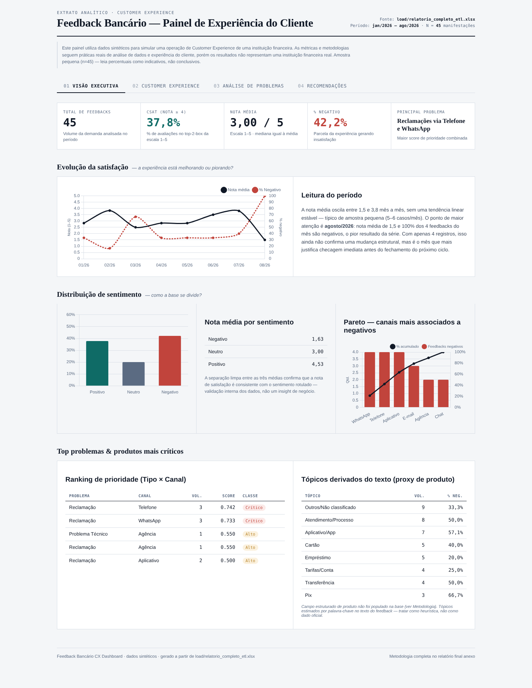
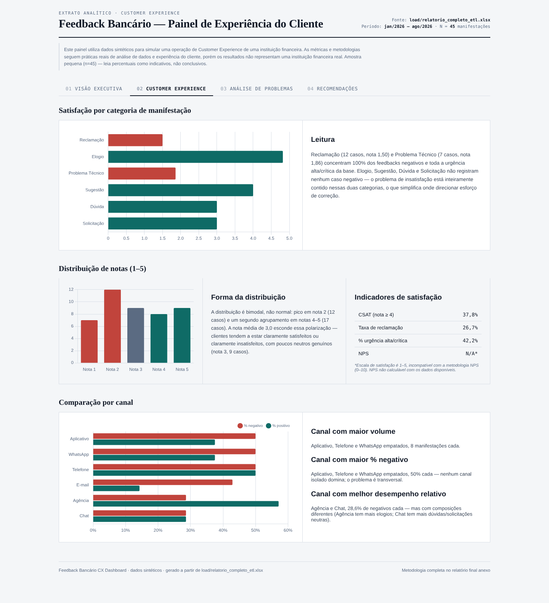
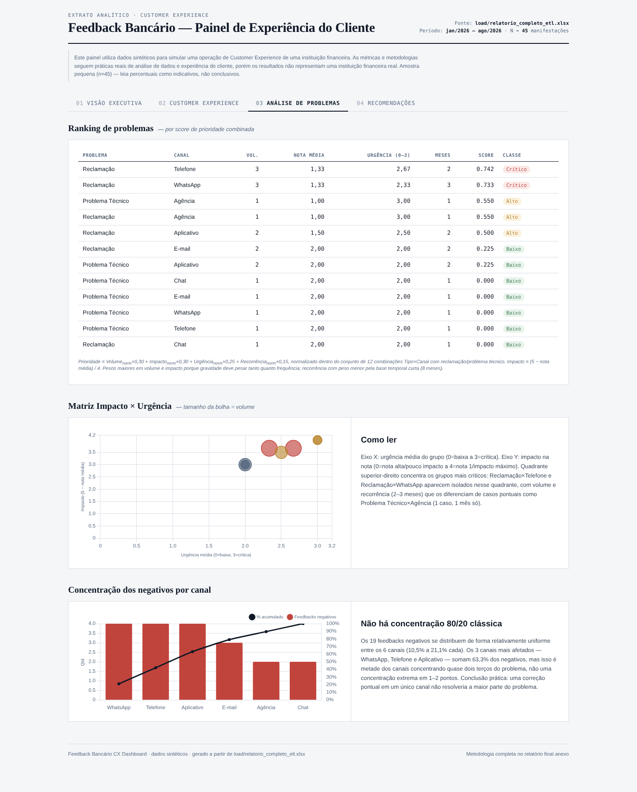
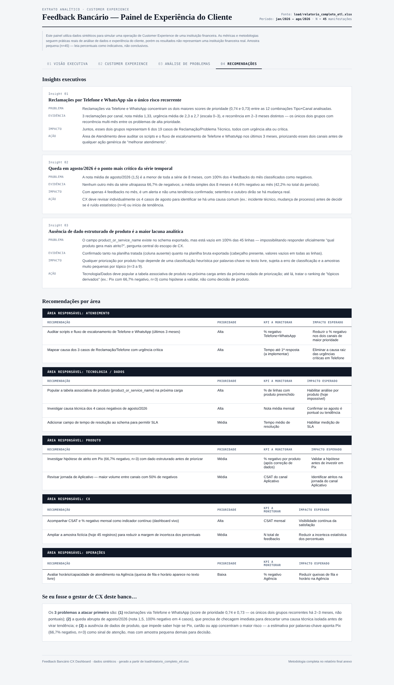

# 🏦 Feedback Bancário — Análise de Feedbacks de Clientes (Dados Fictícios)

> Pipeline completo de ETL + PostgreSQL + Prompt Engineering para transformar feedbacks
> de clientes de um banco fictício em insights e recomendações acionáveis de Customer
> Experience. Projeto de portfólio, 100% dados sintéticos.

[]()
[]()
[]()

📄 **[Ver a conclusão completa da análise →](docs/CONCLUSAO-ANALISE.md)**

---

## 📋 Sumário

- [Fluxo do projeto](#-fluxo-do-projeto)
- [1. Definição do problema](#1-definição-do-problema)
- [2. Objetivo do projeto](#2-objetivo-do-projeto)
- [3. Modelo de dados](#3-modelo-de-dados)
- [4. Metodologia](#4-metodologia)
- [5. Resultado — Conclusão da análise](#5-resultado--conclusão-da-análise)
- [Dashboard e relatório final](#dashboard-e-relatório-final)
- [Como reproduzir](#como-reproduzir)
- [6. Estrutura do repositório](#6-estrutura-do-repositório)
- [7. Limitações](#7-limitações)
- [Autor](#-autor)

---

## 🔄 Fluxo do projeto

<p align="center">
  
</p>

---

## 1. Definição do Problema

### Que feedback será analisado?

Feedbacks fictícios de clientes de um banco digital, cobrindo os principais pontos de
contato e produtos: aplicativo, Pix, cartões, transferências, pagamentos, empréstimos,
atendimento (humano e chatbot), abertura de conta, autenticação/segurança e tarifas.

Os feedbacks combinam texto livre (relato do cliente) com dados estruturados de apoio:
nota de satisfação, sentimento, urgência, canal e tipo de manifestação — todos sintéticos,
sem qualquer dado pessoal real.

### Quem utilizará o resultado?

Áreas hipotéticas do banco fictício que consumiriam essa análise:

- **Customer Experience (CX)** — visão geral da satisfação e dos pontos de atrito
- **Produto** — priorização de melhorias por funcionalidade/canal
- **Atendimento** — gargalos de resolução e canais mais sobrecarregados
- **Operações** — problemas técnicos recorrentes
- **Dados** — insumo para dashboards e monitoramento contínuo

O público combina perfis técnicos (Dados/Produto, que interpretam KPIs e tabelas
detalhadas) e não técnicos (CX/Atendimento/Operações, que precisam do Resumo Executivo
e das Recomendações em linguagem direta e acionável).

### Qual decisão o resultado deve apoiar?

Priorização de ações de melhoria na experiência do cliente, respondendo diretamente à
pergunta central do prompt mestre: **"Quais são os principais problemas enfrentados
pelos clientes, qual o impacto desses problemas e quais ações deveriam ser priorizadas?"**

Na prática, o resultado apoia:

- Priorização de problemas por canal usando uma metodologia objetiva de pontuação
  (volume + impacto + urgência + recorrência), evitando priorizar só por volume;
- Direcionamento de recomendações acionáveis para áreas responsáveis específicas
  (CX, Produto, Atendimento, Dados), com KPI de acompanhamento definido;
- Diferenciação entre problemas críticos e urgentes de baixo esforço de correção;
- Base para decisões futuras de monitoramento contínuo (dashboard).

> Não é objetivo apoiar decisões de negócio reais (ex: aprovação de crédito, análise de
> risco individual) — o escopo é estritamente experiência do cliente com dados fictícios.

---

## 2. Objetivo do Projeto

Analisar feedbacks fictícios de clientes de um banco digital para transformar relatos
individuais em padrões mensuráveis, apoiando a priorização objetiva de problemas e a
definição de ações concretas de melhoria na experiência do cliente — com evidências
quantitativas e recomendações claramente separadas de hipóteses.

---

## 3. Modelo de Dados

Schema normalizado em PostgreSQL (3FN), com tabelas de domínio (`channels`,
`manifestation_types`, `products_services`) e uma tabela associativa N:N
(`manifestation_products`) para permitir que uma manifestação cite mais de um produto.

<p align="center">
  
</p>

| Campo | Descrição |
|---|---|
| `manifestation_id` | Identificador único (fictício) |
| `channel_name` | Canal de origem (App, Chat, Telefone, Agência, E-mail, WhatsApp) |
| `type_name` | Tipo de manifestação (Reclamação, Elogio, Sugestão, Dúvida, Problema Técnico, Solicitação) |
| `feedback_text` | Texto livre do feedback |
| `satisfaction_score` | Nota de 1 a 5 |
| `sentiment` | positivo / neutro / negativo |
| `urgency` | baixa / media / alta / critica |
| `created_at` | Data e hora do feedback |

Scripts completos: [`tables/`](tables/) (criação de tabelas), [`triggers/`](triggers/)
(atualização automática de `updated_at`), [`seeds/`](seeds/) (dados fictícios).

---

## 4. Metodologia

A análise segue um processo estruturado em 8 etapas, definido no prompt mestre do
projeto: [`docs/PROMPT-METODOLOGIA.md`](docs/PROMPT-METODOLOGIA.md).

1. **Qualidade dos dados** — nulos, duplicidades, inconsistências e outliers, sem correção silenciosa.
2. **Análise descritiva** — volumes, distribuição de notas, sentimento, canal, urgência.
3. **Segmentação** — comparação entre canal, tipo, sentimento e urgência.
4. **Análise de problemas** — problemas recorrentes, críticos e por canal.
5. **Análise de relacionamento** — cruzamentos entre variáveis, sem confundir correlação com causalidade.
6. **Priorização** — metodologia objetiva combinando volume, impacto, urgência e recorrência.
7. **Insights** — cada um estruturado como fato → evidência → interpretação → hipótese → impacto.
8. **Recomendações** — ação, responsável, prioridade e KPI de acompanhamento.

**Papel assumido na análise:** Data Analyst Sênior, Customer Experience Analyst,
Business Intelligence Analyst e consultor de decisão orientada por dados.

**Regras críticas seguidas:** uso exclusivo dos dados fornecidos, separação explícita
entre fato/interpretação/hipótese/recomendação, e nenhuma exposição de dados pessoais.

---

## 5. Resultado — Conclusão da Análise

A análise completa (Resumo Executivo, Qualidade dos Dados, KPIs, Principais Problemas,
Insights e Recomendações) está em **[`docs/CONCLUSAO-ANALISE.md`](docs/CONCLUSAO-ANALISE.md)**.

**Destaques:**

- 42% dos feedbacks são negativos, concentrados em Reclamação e Problema Técnico.
- Telefone e WhatsApp concentram as reclamações de maior prioridade (maior gravidade × urgência combinadas).
- A maior lacuna de dados do projeto: a tabela `manifestation_products` nunca foi populada, impossibilitando a análise por produto — documentado como próximo passo prioritário.

<p align="center">
  
</p>

### Dashboard e relatório final

| Entregável | Arquivo |
|---|---|
| Relatório final (dataset, KPIs, insights, problemas, recomendações, limitações) | [`RELATORIO.md`](RELATORIO.md) |
| Dashboard HTML em 4 páginas (Visão Executiva, Experiência do Cliente, Análise de Problemas, Recomendações) | [`docs/dashboard.html`](docs/dashboard.html) |
| Relatório Power BI | [`docs/Relatorio.pbix`](docs/Relatorio.pbix) |
| Base consolidada para Power BI (fato + agregados) | [`load/CX_Bancario_PowerBI.xlsx`](load/CX_Bancario_PowerBI.xlsx) |
| Auditoria de dados | [`docs/AUDITORIA-DADOS.md`](docs/AUDITORIA-DADOS.md) |

### Prévia do dashboard

| 01 Visão executiva | 02 Customer experience |
|---|---|
|  |  |
| **03 Análise de problemas** | **04 Recomendações** |
|  |  |

**KPIs principais (n = 45, dados fictícios):** CSAT 37,8% (nota ≥ 4) · nota média 3,0/5 · 42,2% negativo · taxa de reclamação 26,7%. NPS não é calculável (escala de 1 a 5).

**Prioridades:** Reclamação via Telefone (score 0,742) e via WhatsApp (0,733) são as únicas classificadas como Críticas. Score = volume 30% + impacto 30% + urgência 25% + recorrência 15%, normalizados entre os 12 grupos tipo × canal.

> ⚠️ Todos os dados são sintéticos e não representam uma instituição financeira real.

### Como reproduzir

```bash
pip install -r analysis/requirements.txt
python analysis/full_analysis.py
```

Lê `load/relatorio_completo_etl.xlsx` e gera `analysis/output/dataset_tratado.csv` e `analysis/output/dashboard_data.json`. O dashboard HTML usa Chart.js via CDN, portanto precisa de internet para abrir.

---

## 6. Estrutura do Repositório

```
feedback-bancario/
├── RELATORIO.md                   # Relatório final de CX
├── analysis/                      # Script reproduzível da análise
├── docs/
│   ├── PROMPT-METODOLOGIA.md      # Prompt mestre da análise
│   ├── CONCLUSAO-ANALISE.md       # Resultado da análise (1ª versão)
│   ├── AUDITORIA-DADOS.md         # Auditoria de qualidade dos dados
│   ├── dashboard.html             # Dashboard em 4 páginas
│   └── Relatorio.pbix             # Relatório Power BI
├── tables/                        # Criação das tabelas (schema)
├── triggers/                      # Trigger de updated_at
├── seeds/                         # Dados fictícios (seeds)
├── prompts/                       # Prompts usados para gerar tabelas/exportação
├── staged/                        # CSV/XLSX exportados do PostgreSQL
├── load/                          # Relatório final tratado (ETL)
└── assets/prints/                 # Diagramas e prints do projeto
```

---

## 7. Limitações

- Dados fictícios podem não capturar toda a complexidade de feedbacks reais.
- Amostra de 45 registros é pequena; percentuais devem ser lidos como indicativos, não conclusivos.
- Não é possível segmentar por produto até que `manifestation_products` seja populada.
- Resultados servem para fins de estudo/demonstração, não para decisões reais de negócio.

Lista completa de limitações e ressalvas: ver seção "Limitações" em
[`docs/CONCLUSAO-ANALISE.md`](docs/CONCLUSAO-ANALISE.md).

---

## 👤 Autor

**Gustavo Freitas**
GitHub: [@gustavfreitas](https://github.com/gustavfreitas)
